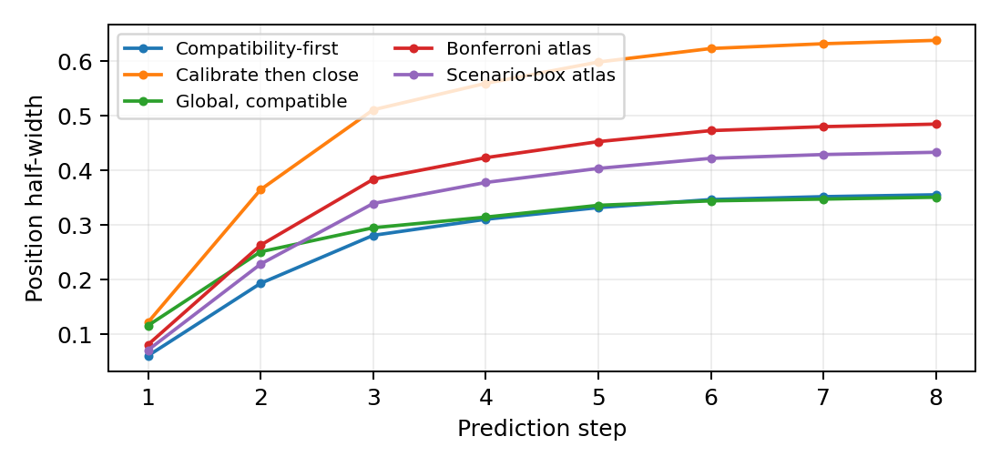
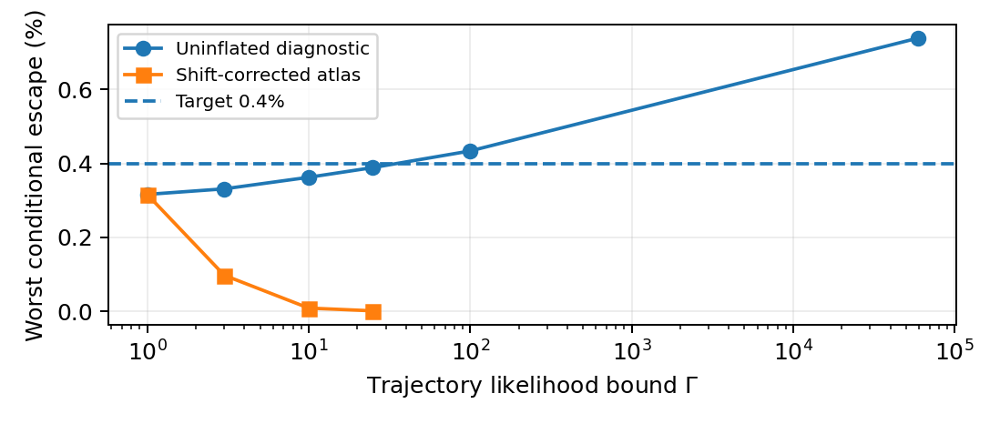

# Contextual Collective-Tube MPC

Reproducibility package for **“Contextual Collective-Tube Model Predictive Control with Finite-Sample Safety Certificates”**, by Giuseppe C. Calafiore.

The [reference paper](paper/contextual_collective_tube_mpc.pdf) is included as the exact supplied 33-page PDF. This package reproduces its **Section 8**, including all three tables and both figures. It contains Python code and synthetic-data generators, together with the numerical results and verification tools. Tables are provided in **CSV and Markdown**; figures are provided in **PDF and PNG**. No LaTeX source or Git history is included.

## Quick start

The tested configuration is **CPython 3.13.5** on Linux x86-64. From the repository root:

```bash
python3.13 -m venv .venv
source .venv/bin/activate
python -m pip install -r requirements.txt
```

On Windows, use `py -3.13 -m venv .venv`, then activate with `.venv\Scripts\Activate.ps1`.

Check the supplied files and run the unit tests:

```bash
python reproduce.py check-reference
python -m unittest discover -s tests -v
python reproduce.py smoke --output runs/smoke
```

Reproduce **the complete paper protocol**:

```bash
python reproduce.py run --study all --output runs/full
```

This generates fresh synthetic samples, calibrates every construction, and solves the closed-loop MPC problems. It also evaluates the feasible-state grid and regenerates the tables and figures. The command finishes with output comparison and independent numerical audits, including a direct check of the printed values in the reference paper. A failed check returns a nonzero exit code.

Use a fresh output directory for each run. The experiment leaves `reference/` and `paper/` unchanged. The full run takes a few minutes on the validation host; runtime depends on the machine. Python's plotting backend is noninteractive, and a commercial optimizer is unnecessary.

## Results and verification

The supplied reference results include **42 CSV files and 78 scientific JSON files**, plus the originating run manifest. Full reproduction compares every scientific file. Discrete outcomes must match exactly; continuous quantities use absolute tolerance `2e-7` and relative tolerance `1e-8`. Timings are recorded separately.

The [validation report](validation/VALIDATION.md) records the executions performed for this release. The checks include **216 comparisons with the paper's printed numerical values**, as well as independent checks of the calibrated risks and transition geometry. Mission dynamics and risk accounting are reconstructed from the recorded random streams.

A complete run writes:

```text
runs/full/
  experiments/results/    Mission logs, calibrated atlases, and study summaries
  tables/                 Tables 1–3 in CSV and Markdown
  figures/                Figures 1–2 in PDF and PNG, plus plotting-data CSVs
  environment.json        Python/package versions and source hashes
  experiment.log          Complete numerical execution log
  assets.log              Table and figure generation log
  verification.json       Reference, geometry, and paper-correspondence checks
  run_status.json         Exit status and elapsed time
```

For inspection without rerunning all simulations:

```bash
python reproduce.py check-paper --report runs/paper-correspondence.json
python reproduce.py assets --output runs/assets
python reproduce.py verify --report runs/reference-verification.json
```

To verify regenerated results again:

```bash
python reproduce.py verify --results runs/full/experiments/results \
  --report runs/full/reverification.json
```

`--exact-csv` additionally requires byte-identical CSV files. Cross-platform floating-point variation can prevent byte identity even when every numerical tolerance passes.

## Experiments

| Study | Paper location | Content |
|---|---|---|
| Benchmark A | Section 8.2; Tables 1–2; Figure 1 | Compatibility-first construction, verified comparators, and no-edge diagnostic |
| Data fairness and replication | Section 8.2 | Equal-total-data comparison and four independent calibration replications |
| Conditional calibration | Section 8.2 | Pooled-mixture diagnostic and context-conditional escape rates |
| Budget and recovery | Section 8.2.1 | Continuation reserve, budget rejection, and artificial-shock recovery |
| Benchmark B | Section 8.3; Table 3; Figure 2 | State/input-dependent shift and sample-rejected corrected designs |

The main protocol uses 1,800 design trajectories and 50,000 calibration trajectories per context. Independent tests use 80,000 trajectories per context. Main comparisons use 120 missions of 22 steps, with trajectory risk target `0.004` and confidence allowance `0.001` per method and experiment. The initial mission budget is `0.1`.

The [paper-to-code map](docs/PAPER_MAP.md) identifies the generating functions and result files. The [experimental protocol](docs/EXPERIMENTS.md) explains the constructions. Exact model parameters and seeds are mirrored in [`config/paper.json`](config/paper.json).

### Figure 1: position half-widths



### Figure 2: deployment-shift diagnostic



The no-edge construction and shifted-law uninflated runs are diagnostics. The recovery test includes an artificial disturbance and retains the **four subsequent state violations** reported in the paper. The two insufficient-sample corrected designs in Benchmark B remain rejected. These outcomes are part of the reference results.

## Individual studies and optional data export

```bash
python reproduce.py run --study A --output runs/A
python reproduce.py run --study B --output runs/B
python reproduce.py run --study budget --output runs/budget
python reproduce.py run --study recovery --output runs/recovery
python reproduce.py run --study mixture --output runs/mixture
```

A grid-only run can use freshly regenerated Benchmark A atlases:

```bash
python reproduce.py run --study grid \
  --input-results runs/A/experiments/results --output runs/grid
```

Partial-result verification requires `--allow-partial`; full reproduction uses `--study all`.

Large raw arrays are generated on demand rather than stored in the release:

```bash
python reproduce.py export-data --benchmark A --seed-offset 0 \
  --include-test --include-mission-primitives --output data/A
python reproduce.py export-data --benchmark B --gamma 3 \
  --include-test --include-mission-primitives --output data/B
```

Each export includes the array shapes and SHA-256 hashes. See the [data dictionary](docs/DATA_DICTIONARY.md) for file definitions and seed conventions.

## Releasing and citing

Upload the **contents** of the extracted `collective-tube-mpc/` folder so this README appears at the repository root. The [publication guide](docs/PUBLICATION.md) covers a fresh upload. The package itself performs no GitHub writes.

Citation metadata are in [`CITATION.cff`](CITATION.cff). The code retains the supplied [MIT license](LICENSE). The reference manuscript retains its author's rights and is outside the software-license scope.

GitHub Actions workflows and an optional Dockerfile are supplied. Their remote execution is outside the local validation performed here. See [reproducibility details](docs/REPRODUCIBILITY.md) for the tested environment and its limitations.
